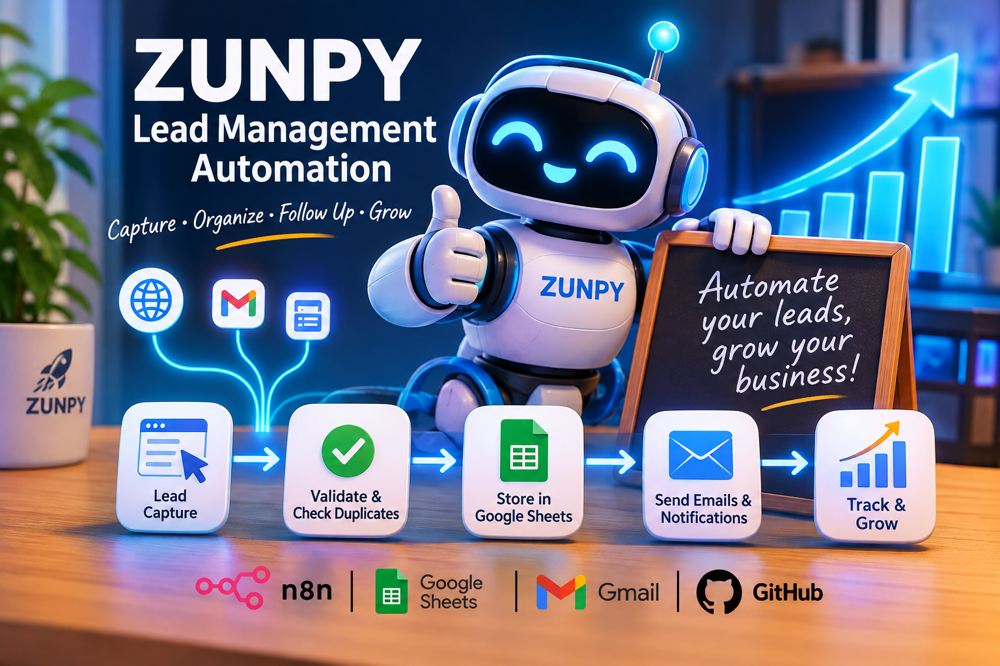

# ZUNPY Lead Management Automation



**Project status:** Verified demo / working prototype  
**Version:** Demo v2  
**Category:** Business Process Automation  
**Business contact:** hello@zunpyai.com

## 1. Project Overview

ZUNPY Lead Management Automation is a workflow-based solution designed to help small service businesses capture, validate, organize and follow up with potential customers and commercial proposals.

The system reduces repetitive lead-management work, centralizes business data, prevents duplicate records, logs activity and helps ensure both lead and quote follow-up actions are not forgotten.

The current demo has been tested end to end in a controlled sandbox environment using fictional or controlled internal test data.

## 2. Problem Statement

Small businesses often receive customer enquiries through different channels but lack a centralized and reliable process to manage them.

This can result in:

- Lost or overlooked enquiries.
- Duplicate customer records.
- Delayed responses.
- Inconsistent follow-up.
- Quotes being forgotten after they are sent.
- Follow-up messages being sent after a customer has already replied.
- Poor visibility into lead and quote activity.

## 3. Verified Demo Flows

### 3.1 Lead Management

The original ZUNPY demo uses n8n to orchestrate five workflow stages:

1. **Lead Intake** — accepts manual, form, webhook or API lead input.
2. **Lead Validation** — validates and normalizes required contact data.
3. **CRM Operations** — creates or updates leads in Google Sheets and detects duplicate matches.
4. **Email Notifications** — sends controlled Gmail notifications and records the activity.
5. **Follow-up Scheduler** — detects due follow-ups, triggers the notification workflow and marks the follow-up as notified.

```text
Lead Intake
    ↓
Validation
    ↓
CRM Operations
    ↓
Email Notifications
    ↑
Follow-up Scheduler
```

### 3.2 Quote Follow-up V1

Demo v2 adds a second verified workflow chain for commercial quote follow-up:

1. **Quote Registration** — validates and registers a quote and blocks duplicate quote IDs.
2. **Due Quote Orchestrator** — detects active quotes whose next action is due.
3. **Reply Guard** — checks the Gmail conversation before any automated follow-up.
4. **Follow-up Sender** — manages a controlled three-stage follow-up sequence.
5. **Human Review & Alerts** — routes replies, terminal no-response cases and errors to human review.

```text
Quote Registration
        ↓
Due Quote Orchestrator
        ↓
Reply Guard
   ┌────┴────┐
REPLIED    NO_REPLY
   ↓           ↓
Human       Follow-up
Review       Sender
                 ↓
            FU1 → FU2 → FU3
                       ↓
                  Human Review
```

The quote follow-up chain was verified end to end in the sandbox using a controlled internal Gmail thread.

## 4. Verified Capabilities

- Lead intake through multiple supported channels.
- Required-field and contact-data validation.
- Google Sheets CRM integration.
- Duplicate detection and controlled create/update logic.
- Activity logging.
- Real Gmail API notification delivery.
- Follow-up scheduling and notification state tracking.
- Quote registration and due-date orchestration.
- Gmail reply detection before automated quote follow-up.
- Three-stage quote follow-up cadence.
- Idempotent follow-up protection to prevent duplicate sends.
- Automatic stop after the final follow-up stage.
- Human-review routing for customer replies, terminal no-response and workflow errors.
- Controlled sandbox testing with fictional or internal test data.
- SPF, DKIM and DMARC passing on the tested ZUNPY business-email delivery path.

## 5. Quote Follow-up Safety Rules

The Quote Follow-up V1 subsystem is intentionally fail-closed.

- A follow-up is never sent unless the reply guard confirms **NO_REPLY**.
- A detected customer reply stops automated follow-up.
- The same follow-up stage cannot be sent twice.
- The sequence ends after FU3; there is no automated FU4.
- Terminal cases are routed to human review.
- Workflow errors are logged and require review.
- Production sending and internal alerts remain disabled in the sandbox configuration.

See [Quote Follow-up V1](docs/11-quote-followup-v1.md) for the subsystem design and test evidence.

## 6. Target Users

- Small service businesses.
- Freelancers and consultants.
- Independent service providers.
- Small sales and operations teams.
- Small businesses that send commercial proposals or quotes and need reliable follow-up.

## 7. Technology Stack

| Technology | Purpose |
|---|---|
| n8n | Workflow orchestration |
| Google Sheets | Lead and quote database / lightweight CRM |
| Gmail API | Automated notifications, reply checks and controlled follow-up |
| Webhooks / REST APIs | Automated data intake |
| JavaScript / n8n Code nodes | Validation and deterministic workflow logic |
| GitHub | Version control and project documentation |

## 8. Demo Scope

The verified demo focuses on reusable lead-management and quote-follow-up workflows using standard integrations.

It includes:

- Lead intake.
- Data validation and normalization.
- Duplicate prevention.
- Centralized lead and quote storage.
- Activity logging.
- Email notifications.
- Lead follow-up scheduling.
- Quote follow-up scheduling.
- Reply detection.
- Three-stage quote follow-up.
- Human-review escalation.
- Idempotency and fail-closed safeguards.

A full custom CRM, large-scale outbound campaigns, advanced analytics, WhatsApp integration, guaranteed conversion results and client-specific production hardening are outside the current demo scope.

## 9. Testing and Verification

The workflows have been tested end to end with fictional or controlled internal data in the ZUNPY sandbox.

Verified evidence includes:

- Successful lead intake and validation.
- Successful CRM record creation.
- Successful activity logging.
- Successful real Gmail API notification delivery from the ZUNPY business domain.
- Successful lead follow-up detection and notification.
- Follow-up state updated to prevent repeated notifications.
- Successful quote-due detection.
- Successful Gmail reply-guard execution.
- Successful controlled real follow-up delivery.
- Successful CRM quote-state update after follow-up.
- Successful duplicate-send blocking.
- Successful terminal handoff to human review after FU3.
- Successful real internal alert delivery and duplicate-alert blocking.
- Successful end-to-end traversal of the quote chain from due detection through human review.
- Business-domain email authentication passing SPF, DKIM and DMARC checks on the controlled test.

## 10. Project Status

**Verified demo / working prototype.**

The core lead-management workflow and Quote Follow-up V1 have both been demonstrated end to end in controlled sandbox conditions.

This repository represents a commercial demonstration and reusable automation foundation, not a claim of universal production readiness.

Client deployment would still require environment-specific configuration, credentials, acceptance testing and any agreed production hardening.

## 11. Security and Privacy

The public demo uses fictional or controlled internal test information.

Credentials, OAuth secrets, API keys, internal workflow IDs, private customer data and personal information must never be committed to the repository.

Production email sending is not enabled by default.

## About ZUNPY

ZUNPY builds practical automation solutions using n8n, Python, APIs and AI-assisted workflows.

The focus is on reducing repetitive business work with solutions that are understandable, maintainable and testable.

**Contact:** hello@zunpyai.com

---

*Built and verified as a practical automation project by ZUNPY.*
