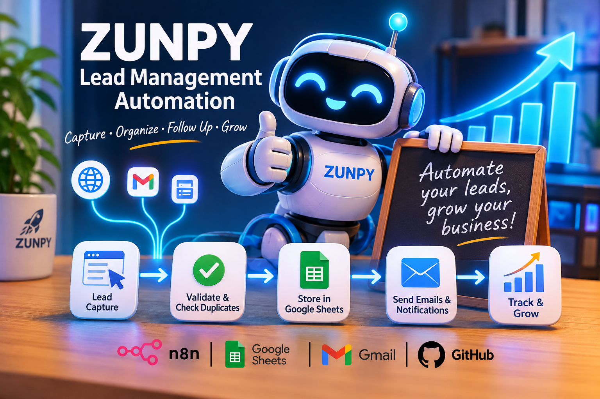

# ZUNPY Lead Management Automation

**Project status:** Planned  
**Version:** 1.1  
**Category:** Business Process Automation

## 1. Project Overview

ZUNPY Lead Management Automation is a workflow-based solution designed to help small businesses and independent professionals capture, organize, and follow up with potential customers.

The system automates repetitive lead management tasks, reduces manual data entry, prevents duplicate records, and helps businesses respond to new enquiries in a timely manner.

It supports both automated lead capture and manual contact registration.

## 2. Problem Statement

Small businesses often receive customer enquiries through different channels but lack a centralized and reliable process to manage them.

This can result in:

- Lost or overlooked enquiries.
- Duplicate customer records.
- Delayed responses.
- Inconsistent follow-up.
- Poor visibility into the sales pipeline.

## 3. Proposed Solution

The proposed solution uses n8n to orchestrate an automated lead management workflow.

It will:

1. Capture incoming leads through a web form or webhook.
2. Allow users to register contacts manually.
3. Validate submitted information.
4. Detect existing contacts and prevent duplicate records.
5. Store lead information in a centralized Google Sheets CRM.
6. Send an automated acknowledgement email when appropriate.
7. Notify the business owner about new enquiries.
8. Track lead status and pending follow-up actions.
9. Provide basic activity reporting.

## 4. Target Users

- Small businesses.
- Freelancers and consultants.
- Independent service providers.
- Small sales and marketing teams.

## 5. Technology Stack

| Technology | Purpose |
|---|---|
| n8n | Workflow orchestration |
| Google Sheets | Lead database and CRM |
| Gmail | Automated email communication |
| Webhooks / REST APIs | Automated data intake |
| Python | Optional custom validation and processing |
| GitHub | Version control and project documentation |

## 6. Project Objectives

- Reduce repetitive administrative work.
- Improve lead data quality.
- Minimize duplicate records.
- Improve response times.
- Centralize contact information.
- Support both manual and automated lead registration.
- Provide a simple and affordable lead management process.
- Create a reusable automation solution.

## 7. Project Scope

The initial version will focus on a single, reproducible workflow using standard integrations.

It will include:

- Web form and webhook lead capture.
- Manual lead registration.
- Data validation and duplicate prevention.
- Centralized lead storage.
- Email acknowledgements and notifications.
- Basic lead status tracking.
- Simple activity reporting.

A full CRM platform, advanced analytics, paid third-party services, and complex multi-channel campaigns are outside the initial scope.

## 8. Expected Deliverables

- Documented automation architecture.
- Exportable n8n workflow.
- Configurable Google Sheets CRM template.
- Manual and automated lead registration.
- Email notification and acknowledgement automation.
- Test cases and execution evidence.
- Installation and configuration instructions.
- GitHub repository with reproducible setup documentation.

## 9. Important Note

This document describes the planned solution. Currently, the project is in the documentation and planning phase; implementation and testing have not yet been completed. Features will only be marked as implemented and verified after successful testing. Detailed installation, configuration, and usage instructions will be added as the implementation progresses.
